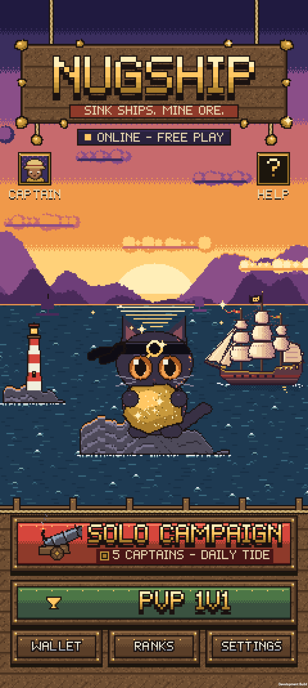
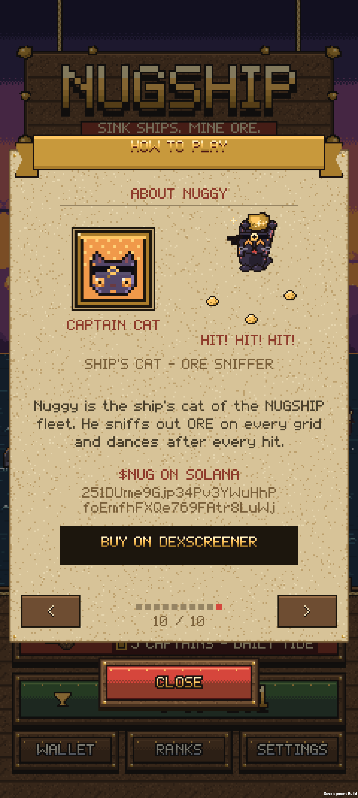
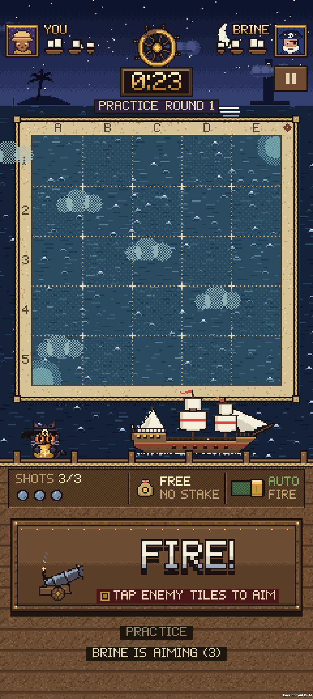
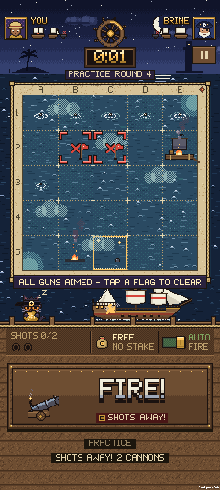
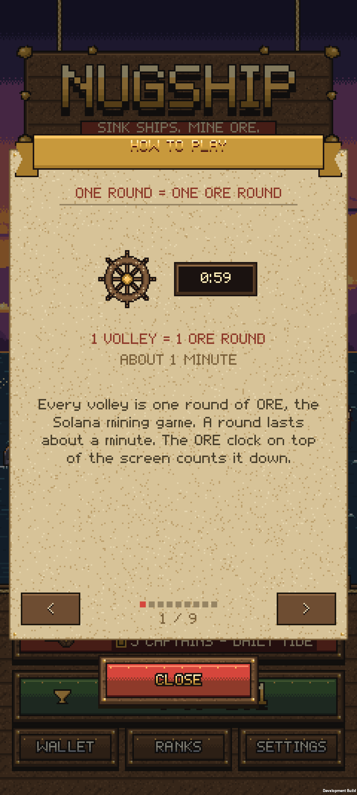
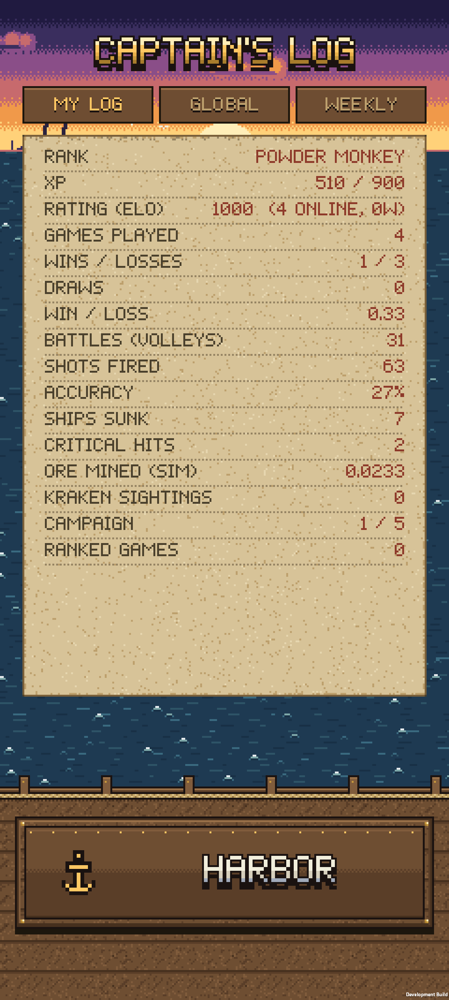

# NUGSHIP

**Sink ships. Mine ORE.** A native Android PvP naval duel for the Solana Seeker — every turn is a live ORE mining round, every cannon shot is an ORE deploy.

[Demo (Loom)](https://www.loom.com/share/9113d22457424ff8906953e71b930553) · [Release v1.0-clockin](https://github.com/lamby4114/nugship/releases/tag/v1.0-clockin) · [APK (sideload)](https://github.com/lamby4114/nugship/releases/download/v1.0-clockin/Nugship-dev.apk) · [Pitch deck](https://github.com/lamby4114/nugship/releases/download/v1.0-clockin/pitch_deck.pdf)

Built solo for the Solana Mobile **CLOCK IN** hackathon.

<p align="center">
  
  
  
  
  
  
</p>

---

## Who it's for

**Seeker owners and ORE miners who want a reason to come back every day** — not another silent mining dashboard.

- Hide a galleon (3), sloop (2) and raft (1) on ORE's own 5×5 grid. Each turn both captains lock on the same Solana slot; every shot is a Deploy on that square.
- Hit = explosion. Splash on ORE's winning square = gold bubbles (ORE mined). Hit *on* the winning square = **CRITICAL HIT**. Motherlode (1/500) = **THE KRAKEN RISES**.
- **Retention loop:** Solo campaign (5 AI captains) → Daily Tide (date-seeded) → ranked 1v1 Elo / invite codes → weekly leaderboards → rank-unlocked cosmetic fleets (Driftwood → Motherlode). Free practice needs no wallet; real SOL only when you opt in.

No PvP wagering, no in-game token, no NFTs. ORE is the only on-chain product. Nuggy is a mascot.

---

## What's technically novel

1. **ORE Automation one-approval session.** At match start, Seed Vault (MWA) signs once: fund a per-match session key and open an ORE Automation account with that key as `executor` and a capped deposit. Each turn's Checkpoint+Deploy is signed in-app — no mid-battle popups. `AutomateClose` refunds the remainder at match end. Manual per-shot signing is the fallback.
2. **Commit-reveal fleets.** Layout sealed as `sha256(layout[25] ‖ salt[32])` before turn 1; both fleets revealed and verified on-device at match end. Shared test vectors in TS and C#.
3. **Server referee reads Miner PDAs.** After `end_slot` the Node referee reads each player's ORE Miner account (fallback: `DeployEvent` logs). A shot counts only if that square has ≥ the per-shot amount deployed in that round *and* was locked. The server never holds keys and never signs.
4. **On-chain / off-chain boundary (`LIVE_ORE`).** `ServerConfig.LIVE_ORE` is a compile-time `const` (also gated by the `ORESEAS_LIVE_ORE` scripting define). While off, the wallet is never sent to the server, matches are virtual, and MWA is never asked to sign. **Submitted build: `LIVE_ORE=false`** — live mainnet round *following* (real round IDs, winning square, Motherlode) is on; player deploys stay gated until the dApp Store release. Instruction encodings are byte-tested against mainnet fixtures (`server/test/ore-encoding.test.ts`).

See `docs/ORE_INTEGRATION_BRIEF.md` for the ORE prize criteria mapping.

---

## Repo map

```
unity/OreSeas/                  Unity 6000.3.20f1 client (portrait 1200×2670)
  Assets/OreSeas/Scripts/       Game, Screens, Net, Ore/, Services/Wallet.cs (MWA)
  Assets/OreSeas/Scripts/Runtime/Ore/Chain/   OrePda, OreInstructions, OreDecode, OreAccounts
  Assets/OreSeas/Scripts/Runtime/Net/ServerConfig.cs   LIVE_ORE gate
  Assets/Plugins/Android/       Android / MWA glue
  Packages/manifest.json        Solana.Unity-SDK (git)
server/                         Node 20 + TypeScript matchmaking + referee
  src/ore/                      ORE PDAs, instructions, constants (TS twin of the C# layer)
  src/game/                     fleet commit-reveal, match, AI captains
  src/chain/                    read-only round follower + Miner PDA reader
  src/net/                      WebSocket protocol (PROTOCOL.md)
  test/                         36 tests incl. mainnet encoding fixtures
docs/                           pitch deck, ORE brief, timing notes, Seeker screenshots
assets/audio/                   original chiptune + SFX
```

---

## Build & run

### Server (Node 20)

```bash
cd server
npm ci
npm test                         # ORE encoding vs mainnet fixtures, game rules, referee
ROUND_SOURCE=replay npm run dev  # replay real ORE rounds at 10× → ws://localhost:8787/ws
npm run dev                      # follow live mainnet ORE (read-only RPC)
```

Deploy notes: `server/HOSTING.md`, `server/fly.toml`.

### Client (Unity 6000.3.20f1 + Android module)

1. Open `unity/OreSeas` in Unity Hub (Solana.Unity-SDK resolves from git on first open).
2. Play `Assets/Scenes/Main.unity` (portrait 1200×2670).
3. Build APK: **NUGSHIP › Build Android Dev APK**, or batch:
   ```
   Unity -batchmode -quit -projectPath unity/OreSeas -buildTarget Android \
     -executeMethod OreSeas.EditorTools.BuildScript.BuildAndroidDev
   ```
4. Local server: `adb reverse tcp:8787 tcp:8787` (dev client defaults to `ws://127.0.0.1:8787/ws`).

Install the submitted APK: `adb install -r Nugship-dev.apk`

---

## Submitted build (CLOCK IN)

| | |
|---|---|
| Tag | [`v1.0-clockin`](https://github.com/lamby4114/nugship/releases/tag/v1.0-clockin) |
| Commit | [`17a6d87`](https://github.com/lamby4114/nugship/commit/17a6d87) — APK built from this tree |
| APK | [Nugship-dev.apk](https://github.com/lamby4114/nugship/releases/download/v1.0-clockin/Nugship-dev.apk) |
| SHA-256 | `ed93bbe3a007269d7f78b254c25da77ba0ea4098b45162d23ea5d98034851530` |
| Live deploys | Gated (`LIVE_ORE=false`); live ORE round following is on |

**Quick test on a Seeker:** install APK → SOLO CAMPAIGN → Barnacle (no wallet, no server). PvP / leaderboards need the server from `server/` (not publicly hosted yet).

---

## License

Code under `server/` and `unity/**/Scripts`: Apache-2.0 (see `LICENSE`). Art, audio, Nuggy character and the NUGSHIP name/logo: all rights reserved.

Built on [ORE](https://github.com/regolith-labs/ore) by Regolith Labs and the Solana Mobile Stack.
