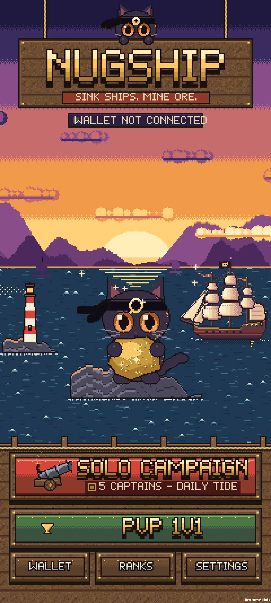
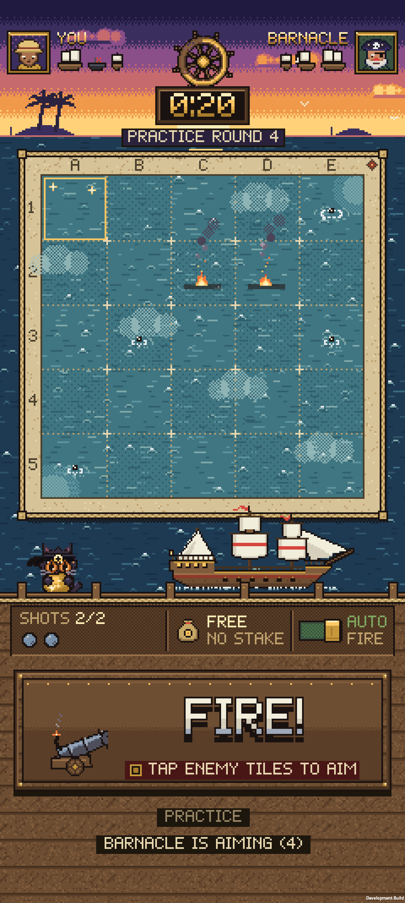
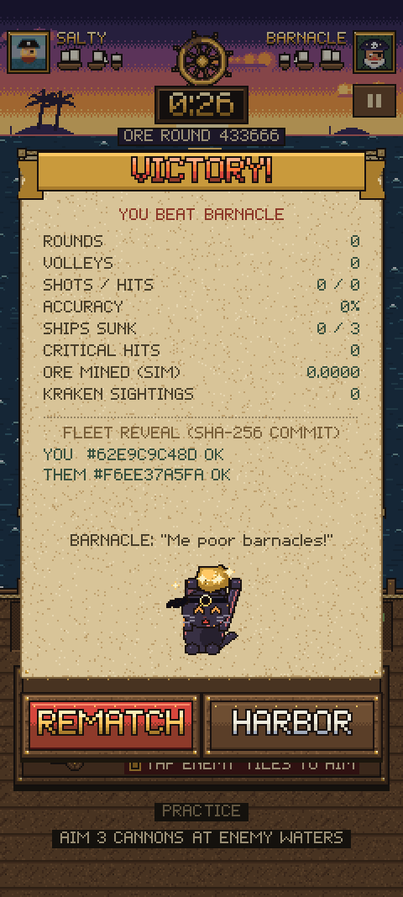
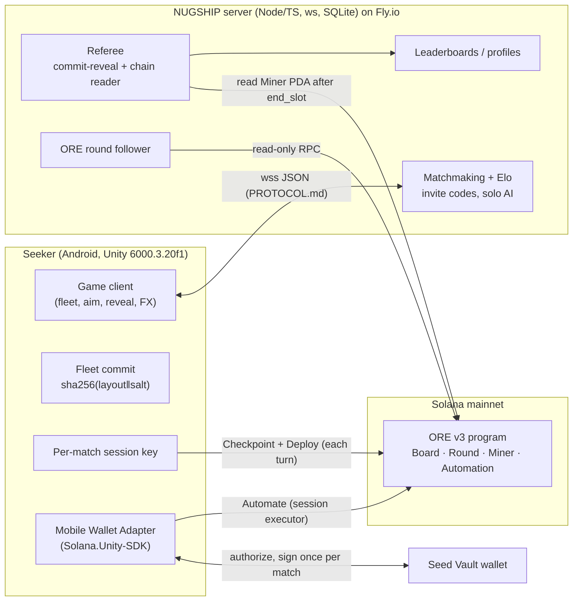

<!-- Draft README for the public/judged GitHub repo. Replace [PLACEHOLDERS]. Keep claims in sync with the build you submit. -->
# NUGSHIP: Sink ships. Mine ORE.

**A native Android PvP naval duel for the Solana Seeker. Every turn is a live ORE mining round, and every cannon shot is an ORE deploy.**

<p align="center">  </p>

Built solo by Vittorio Difusco for the Solana Mobile **CLOCK IN** hackathon (RadiantsDAO).
Demo video: [VIDEO_URL] · Pitch deck: [DECK_URL] · APK: [RELEASE_URL] · X: [X_HANDLE]

---

## What it is

Each player hides a fleet on a 5×5 grid: a galleon (3), a sloop (2) and a raft (1). Those 25 squares are **ORE's 25 squares**.
Each turn both captains pick their shots, and both lock at the same Solana slot. Every shot is a real ORE v3 **Deploy** on that
square. When the ORE round settles, hits are checked against the hidden fleet, and then ORE's winning square comes in:

| | Not ORE's winning square | ORE's winning square |
|---|---|---|
| **Miss** | splash | splash + gold bubbles (ORE mined) |
| **Hit** | explosion | **CRITICAL HIT** (nugget burst, Nuggy the ship's cat dances) |

A **Motherlode** round (1 in 500) triggers **THE KRAKEN RISES**. Salvo size = ships still afloat (3→1), with +1 bonus shot after a sink or a crit.
There is a 15-turn cap.

Modes:
- **Solo campaign** vs 5 AI captains: Barnacle, Admiral Brine, Mad Molly, Ghost Captain and the Kraken Cult boss. Each has a different hunting algorithm.
- **Daily Tide**, a date-seeded daily challenge.
- **1v1 ranked quick match** (Elo) and **invite codes**.
- **Leaderboards** (global + weekly: games, W/L, ratio, battles, Elo), a captain's log and rank-unlocked cosmetic fleets
  (Driftwood → Merchant Cog → Pirate Brig → Navy Frigate → Ironclad → Ghost Fleet → Motherlode). Everyone gets the same hulls and hitboxes, and XP is never sold.
- 6 biomes with day/night and weather, an original chiptune score, and a profile creator (name + pixel portrait or uploaded 20×20 PFP).

**Not in the game:** player-vs-player wagering, any in-game token (Nuggy is a mascot, not a coin), NFTs or tradeable items. ORE is the only on-chain product.

## ORE integration, in detail

| Game concept | ORE v3 (program `oreV3EG1i9BEgiAJ8b177Z2S2rMarzak4NMv1kULvWv`) |
|---|---|
| Turn | One ORE round: a 240-slot deploy window (~64 s) plus a 48-slot intermission (~13 s). The clock is driven by slots, not wall time. |
| Board square A1…E5 | ORE square index 0…24 (`square = row*5 + col`), i.e. bit *i* of the Deploy square mask |
| Volley | One `Deploy` instruction with the volley's square mask, same lamports per square, bundled with `Checkpoint` of the player's previous round in a single tx |
| Lock | `end_slot − 20` (auto-fire) or `end_slot − 60` (manual signing), the same slot for both players |
| Critical hit | Hit on the round's winning square (`xor(4×u64 of slot_hash) % 25`) |
| Kraken event | Motherlode round |
| ORE mined | ORE's own checkpoint math on the player's Miner account (shown before ORE's claim fee) |

**One approval per match (Seed Vault):** at match start the wallet signs once through Mobile Wallet Adapter. That transaction funds a small
SOL float for a per-match in-app **session key**, and opens an ORE **Automation** account with that session key as `executor`
and a capped `deposit` budget. The session key then signs each turn's Checkpoint+Deploy in-app, so there are no per-turn popups. At match end,
`AutomateClose` refunds what's left of the budget. If you'd rather approve every shot, per-shot signing (manual mode) is available.

**The referee reads the chain.** The server never signs or sends transactions. After `end_slot` it reads each player's ORE Miner
PDA. A shot counts only if that square has at least the per-shot amount deployed in that round **and** it was locked. If the miner has already moved on, it falls back to the `DeployEvent` logs.
SOL deployed on a square you didn't lock still mines ORE, but it isn't a shot.

Measured on mainnet (read-only, Oct 7 2026; see `timing/FINDINGS.md`): 289 slots start-to-start (~77 s), 48-slot intermission,
~0.267 s/slot, ~144–152 miners and ~10.3–10.8 SOL per round. Deploy has no minimum amount, but there's one deploy per square per round per miner.

> **SOL risk.** ORE deploys are real SOL. SOL on a square that doesn't win goes to the winning square's miners, and ORE takes fees.
> Our reading of the program puts the expected fee cost at about 10.5% of deployed SOL. A single-square deploy will usually be lost. The game shows the per-shot amount
> before you approve, and free practice/solo modes need no wallet.

## Architecture



## Repo layout

```
unity/OreSeas/      Unity client (C# namespaces OreSeas.*, package com.nugship.game)
csharp/             OreSeas.Ore: C# ORE layer (PDAs, decoders, instruction builders) + tests
server/             Node/TS server: protocol, referee, ORE layer, SQLite, Fly.io config (PROTOCOL.md, HOSTING.md)
mockups_v2/ unity_export/ audio/   art + audio pipelines (sources for the sprite atlases and chiptune)
timing/             read-only ORE timing measurements (FINDINGS.md)
```

## Build & run

**Server** (Node 20):
```bash
cd server
npm ci
npm test                                   # 36 tests: ORE encoding vs mainnet fixtures, game rules, referee
ROUND_SOURCE=replay npm run dev            # replays real ORE rounds at 10x on ws://localhost:8787/ws
npm run dev                                # follows live mainnet ORE rounds (read-only)
npm run sim -- --source replay --speed 25  # 4 bot matches end-to-end, no transactions
```
Deploy: `fly launch --no-deploy`, then `fly volumes create nugship_data --size 1`, then `fly deploy` (see `server/fly.toml`, `server/HOSTING.md`).

**Client** (Unity 6000.3.20f1 with the Android module):
1. Open `unity/OreSeas` in Unity Hub. Packages resolve on first open (Solana.Unity-SDK from git).
2. Play in the editor with `Assets/Scenes/Main.unity` (portrait 1200×2670).
3. Build an APK from **NUGSHIP › Build Android Dev APK**, or in batch mode:
   `Unity -batchmode -quit -projectPath unity/OreSeas -buildTarget Android -executeMethod OreSeas.EditorTools.BuildScript.BuildAndroidDev`
4. To test against a local server: `adb reverse tcp:8787 tcp:8787` (the dev client defaults to `ws://127.0.0.1:8787/ws`; you can change it in SETTINGS › SERVER).
5. Compile check + self-test: `-executeMethod OreSeas.EditorTools.BuildScript.CompileCheck`.

Install a prebuilt APK: `adb install -r Nugship-[VERSION].apk` (sha256: `[APK_SHA256]`).

## Security model

- **`LIVE_ORE` hard gate (client).** `ServerConfig.LIVE_ORE` is a compile-time `const`, and the Deploy/Automate builders only compile
  with the `ORESEAS_LIVE_ORE` scripting define. While it's off, the wallet is never sent to the server, every match is off-chain ("virtual"),
  `lock.fire` is ignored and MWA is never asked to sign. It is deliberately not a runtime setting. *Current state: [OFF / ON in build X.Y].*
- **SIWS pairing gate.** Sign-In-With-Solana profile pairing is gated on both sides (`SIWS_PAIRING`, `ALLOW_WALLET_PAIRING`).
- **Server is read-only on chain.** It holds no keys, never signs, and treats `fired {signature}` as informational. It reads chain state itself.
- **Session key scope.** It's generated per match and only ever funded with a small fee float. It can only spend through ORE Automation up to
  the budget the player approved, and it's closed (refunded) at match end.
- **Fleet integrity.** Each layout is committed as `sha256(layout[25] ‖ salt[32])` with a fresh salt per match. Both commits are exchanged before turn 1,
  and both fleets are revealed and **verified on the phone** at match end (a mismatch flags the match). Shared test vector in the TS and C# tests.
  *Trust note:* the server sees both layouts so it can referee. It never sends unsunk ship cells to the opponent, and the commit
  proves the layouts weren't changed mid-match.
- **Fair timing.** Aims are hidden until lock (the opponent only sees a count). Both players lock on the same slot, and aims after lock are ignored.
- **Auth.** Each WebSocket session starts with a server nonce challenge. Ranked play with a wallet needs a SIWS-verified wallet (`REQUIRE_WALLET_PROOF=true`).
  Guest ids carry a private `guestKey` (only its sha256 is stored).
- **Secrets.** RPC URLs with API keys live in `fly secrets`. Never commit keystores, `*.keystore`, `.env` or credential files (see `.gitignore`).
- Report vulnerabilities to [SECURITY_CONTACT].

## License (suggested)

- **Code** (`server/`, `csharp/`, `unity/**/Scripts`): **Apache-2.0**. It's permissive, includes a patent grant and matches ORE's own Apache-2.0 license.
  MIT also works if you prefer it shorter.
- **Art, audio, the Nuggy character and the NUGSHIP name/logo:** **All rights reserved** (or CC BY-NC 4.0 if you want community remixes). This keeps the brand
  protected while the code stays open.
- Third-party: Solana.Unity-SDK (magicblock-labs), Unity packages; the pitch deck uses Press Start 2P and VT323 (SIL OFL). Keep their licenses in `THIRD_PARTY_NOTICES.md`.
  *Confirm the provenance of the REELM font and wood texture in `reelm_ref/` before publishing.*

## Credits

Design, code, art pipeline and music: Vittorio Difusco. Built on [ORE](https://github.com/regolith-labs/ore) by Regolith Labs and the Solana Mobile Stack.
